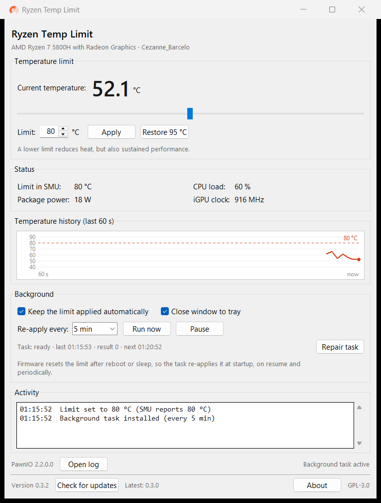

# Ryzen Temp Limit

A small Windows GUI that caps the temperature of AMD Ryzen CPUs (desktops and
laptops) by writing the SMU thermal limit through the signed **PawnIO** driver.



## Why

Windows 11 now blocks the old `WinRing0` driver that `ryzenadj` and
Ryzen Controller used, and Defender actively removes `WinRing0x64.sys`.
Those tools fail with `Unable to init ryzenadj` / `unable to apply ryzenadj`.

This project uses [PawnIO](https://pawnio.eu/), a Microsoft-signed kernel
driver, together with [ZenMaster](https://github.com/HorizonUnix/ZenMaster)
(the `zenmaster` Python package) to talk to the SMU without the blocked driver.

## Features

- Set a temperature ceiling (`Tctl`, SMU `THM LIMIT CORE`) in °C.
- Live readout of current Tctl, load, package power and iGPU clock.
- Read-back of the limit actually stored in the SMU.
- Optional background scheduled task that keeps the limit applied:
  at logon, after resume from sleep and every N minutes.
- Task status line (last run, result, next run) and a repair button.
- Restore the original SMU limit (captured before the app took over; falls
  back to 95 °C when it was never captured) and pause the automatic re-apply.
- Update checker: asks GitHub on start, shows installed and latest versions,
  and can download, verify and install a new release by itself.
- Single-instance guard, per-user settings, About dialog with licenses and a
  one-click diagnostics copy.
- Notification-area icon with quick actions and an optional close-to-tray.
- No WinRing0, no unsigned drivers, no kernel patch.

## Requirements

- Windows 10/11 (64-bit).
- An AMD Ryzen CPU supported by ZenMaster (Zen 1 through Zen 5).
- [PawnIO](https://github.com/namazso/PawnIO.Setup/releases/latest) installed.
- Python 3.10+ if you run from source.

## Install

1. Install the PawnIO driver (signed, by namazso):
   <https://github.com/namazso/PawnIO.Setup/releases/latest/download/PawnIO_setup.exe>
2. Install the app:

   ```powershell
   git clone https://github.com/socrabs151/ryzen-temp-limit.git
   cd ryzen-temp-limit
   py -m venv .venv
   .venv\Scripts\python.exe -m pip install -e .
   ```

3. Run it (it will ask for administrator rights through UAC):

   ```powershell
   .venv\Scripts\ryzen-temp-limit-gui.exe
   ```

   or, without installing the package:

   ```powershell
   .venv\Scripts\python.exe run.py
   ```

## Usage

- Set **Temperature limit** and press **Apply**.
- Tick **Keep applied in the background** to install a scheduled task that
  re-applies the limit automatically. The task runs as the current user.
- **Run now** triggers the background task once.
- **Pause** removes the background task; the current limit stays until reboot.
- **Restore** applies the SMU limit that was present before the app first
  managed it. That value is captured once, on a start where no background task
  exists. If it was never captured (the app was already managing the limit),
  the button says so and falls back to 95 °C. To capture the firmware default,
  pause the task, reboot, then start the app.
- Untick the checkbox to remove the task.
- The tray icon offers **Show window**, **Apply limit**, **Restore**, **Pause**,
  **Check for updates** and **Exit**. With **Close window to tray** enabled,
  closing the window hides it instead of quitting.

The temperature ceiling is *volatile*: the SMU forgets it on reboot, resume
and sometimes on firmware resets. That is why a background task exists at all —
any tool that changes `--tctl-temp` has the same limitation.

## Updates

On start the app asks GitHub for the latest release. If a newer version exists,
it offers to update. The bottom bar also has a **Check for updates** button and
shows the installed and the latest known version.

Packaged builds download the new release, verify its SHA-256 checksum, replace
their own files after the process exits and restart. A source checkout opens
the release page instead.

Releases are produced from tags by `.github/workflows/release.yml`:

```text
v0.2.0
├── RyzenTempLimit-win64.zip      (onedir build, fast start)
├── RyzenTempLimit-onefile.exe    (single file)
├── sha256sums.txt
└── source archives (added by GitHub)
```

The workflow refuses to publish if the tag and `ryzen_temp_limit.__version__`
differ. To ship a new version, bump the version, commit, then push a matching
`vX.Y.Z` tag.

### Antivirus notes

The application is unsigned, so heuristics may complain about things that are
legitimate here:

- the background job is a scheduled task that runs **as the current user**
  (`InteractiveToken`, highest privileges) at logon and calls
  `ryzen-temp-limit --apply-only`. It is not a SYSTEM service;
- updates are downloaded to `%LOCALAPPDATA%\RyzenTempLimit\update`, verified
  against the published SHA-256 and applied after the app exits.

If Defender flags a build as `Behavior:Win32/Persistence`, it is a false
positive — submit the file to Microsoft. Code signing is the long-term fix.

## Build a standalone executable

Default build produces a folder (`onedir`), which starts in about 0.3 s:

```powershell
powershell -ExecutionPolicy Bypass -File scripts\build.ps1
```

Result: `dist\RyzenTempLimit\RyzenTempLimit.exe` (~28 MB folder).

A single-file build is also available. It is ~12 MB but takes 1–1.5 s to start
because it unpacks itself on every launch:

```powershell
powershell -ExecutionPolicy Bypass -File scripts\build.ps1 -OneFile
```

Result: `dist\RyzenTempLimit.exe`.

Build artefacts are not committed — `dist/` is ignored. Ship them as GitHub
Release assets. Either build still needs the PawnIO driver on the target
machine, and a manual launch still asks for administrator rights (UAC).

## Where data lives

- Settings: `%LOCALAPPDATA%\RyzenTempLimit\settings.json`
- Log: `%LOCALAPPDATA%\RyzenTempLimit\app.log`
- Downloaded updates: `%LOCALAPPDATA%\RyzenTempLimit\update`
- Scheduled task: `RyzenTempLimit` (current user, highest privileges)

Settings from the old `%ProgramData%\RyzenTempLimit` location are migrated
automatically on first start.

The application has no telemetry; see [PRIVACY.md](PRIVACY.md).

## Uninstall

1. Untick **Keep applied in the background** and close the app.
2. Delete the folder `%ProgramData%\RyzenTempLimit`.
3. Optional: uninstall PawnIO and any other hardware tools that used it.

## Notes and limitations

- Lower temperatures mean lower sustained performance. A limit well below the
  firmware default will throttle aggressively under load.
- This is a software limit. It does not fix dust, a dried thermal paste or a
  failing fan — if a laptop shuts down from overheating, service the cooling.
- Only the thermal limit is exposed. The CLI backend (`zenmaster`) supports
  other SMU knobs, but this GUI intentionally stays small.
- The `zenmaster` package is a third-party project and is pinned below 2.0.
- Not affiliated with AMD, HP, namazso or the ZenMaster authors.

## Code signing policy

Free code signing provided by [SignPath.io](https://signpath.io/), certificate by [SignPath Foundation](https://signpath.org/).

See [SIGNING.md](SIGNING.md) for the build and signing details.

## License

GNU General Public License v3.0. See [LICENSE](LICENSE).

The project is GPL-3.0 because binary builds bundle
[zenmaster](https://github.com/HorizonUnix/ZenMaster), which is GPL-3.0-only.
Source is always available in this repository; any redistributed build must
comply with the GPL (ship the license and make the corresponding source
available).

Third-party components and their licenses are listed in
[THIRD_PARTY_NOTICES.md](THIRD_PARTY_NOTICES.md).
